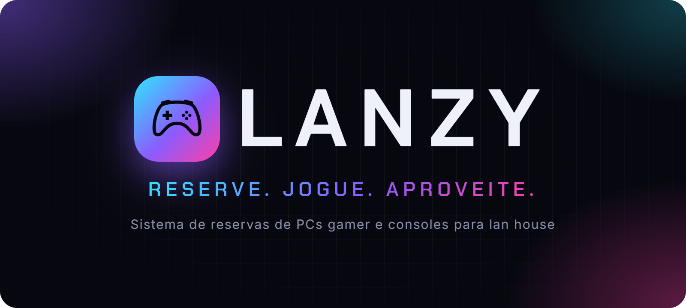
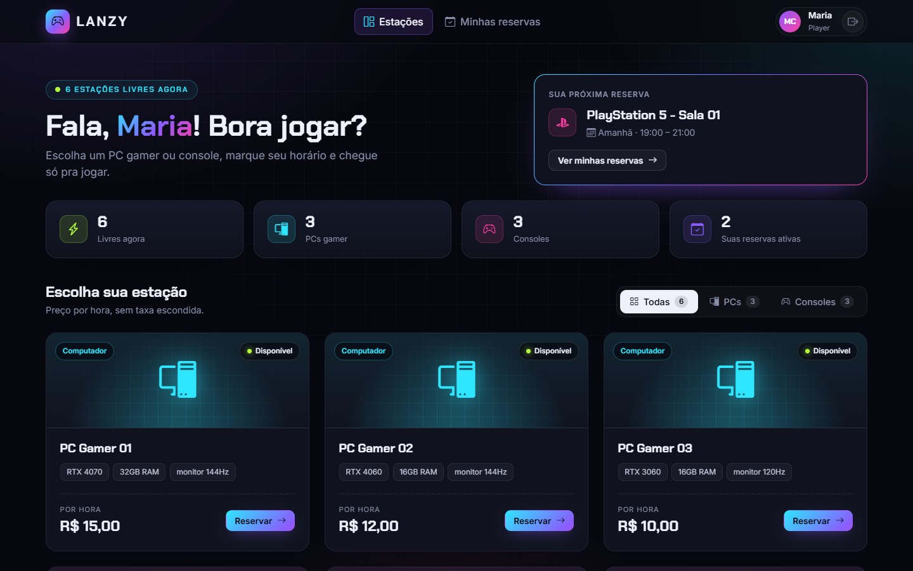
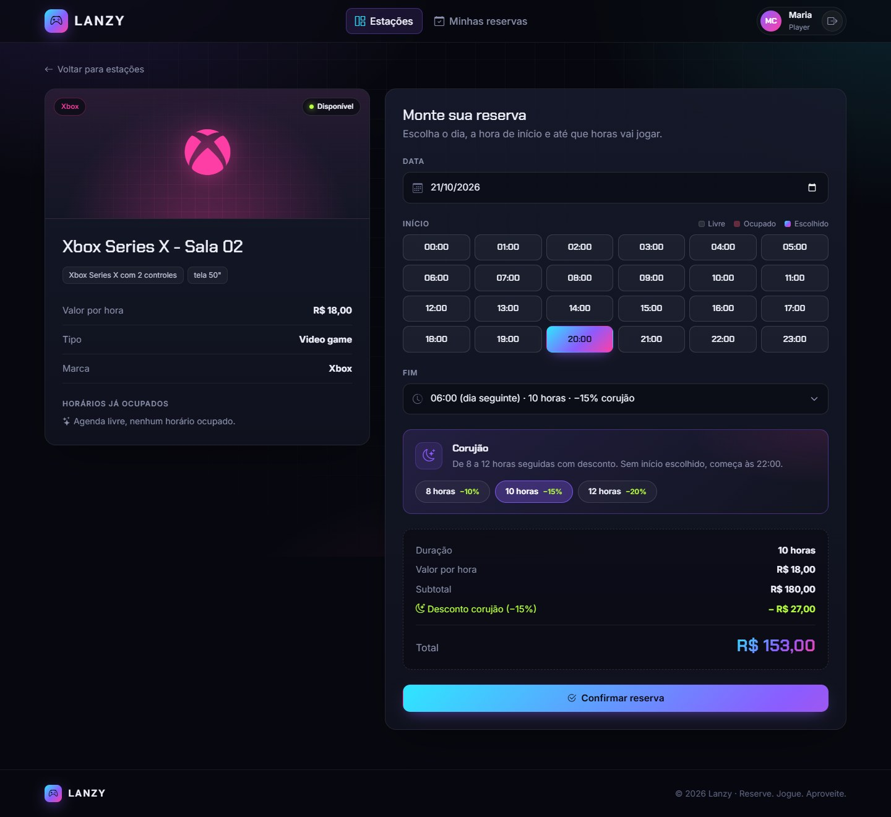
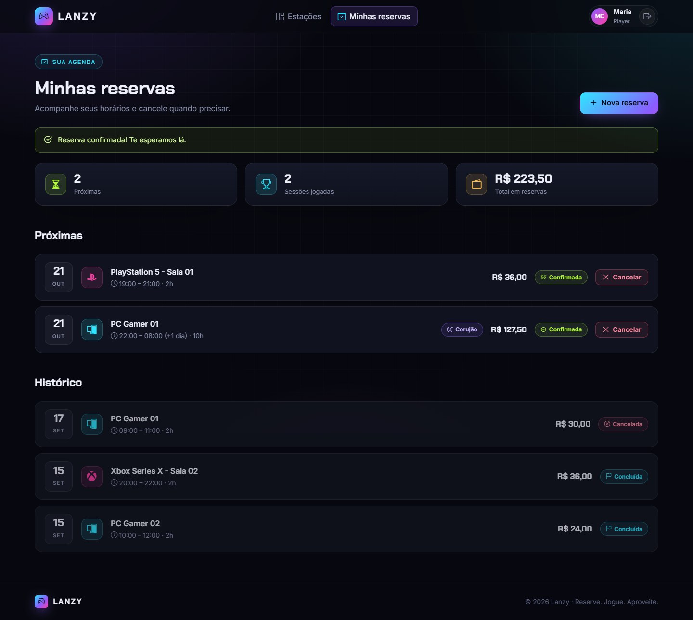
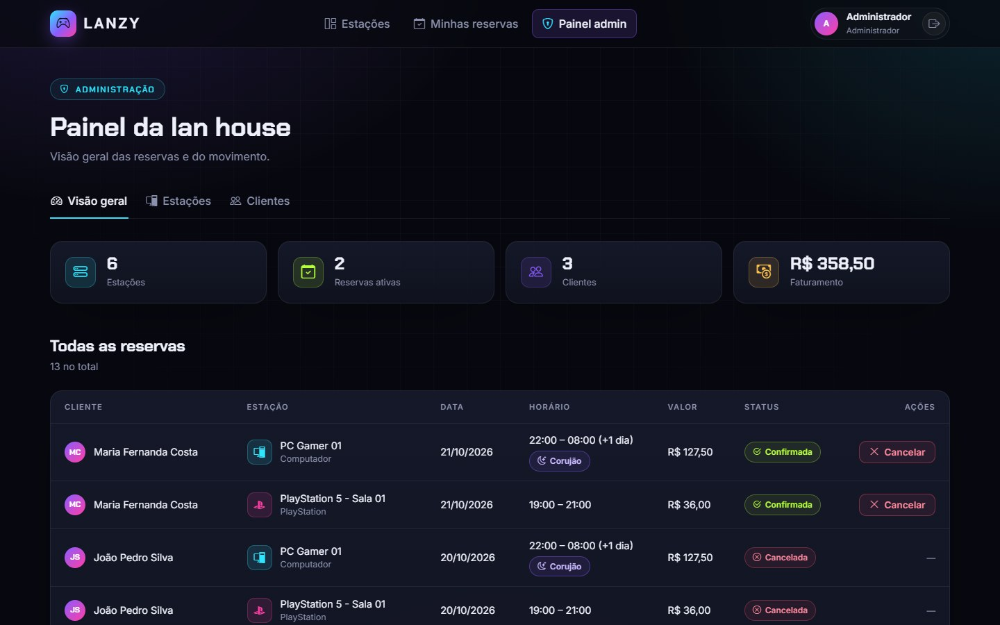
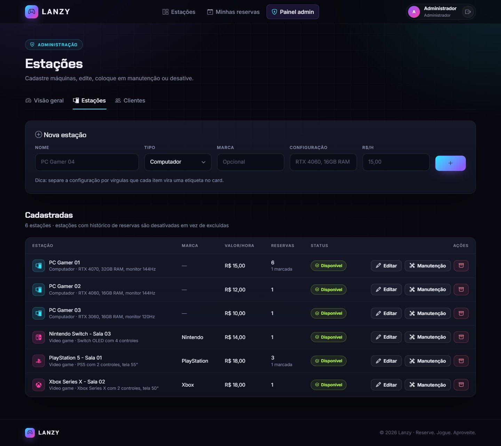
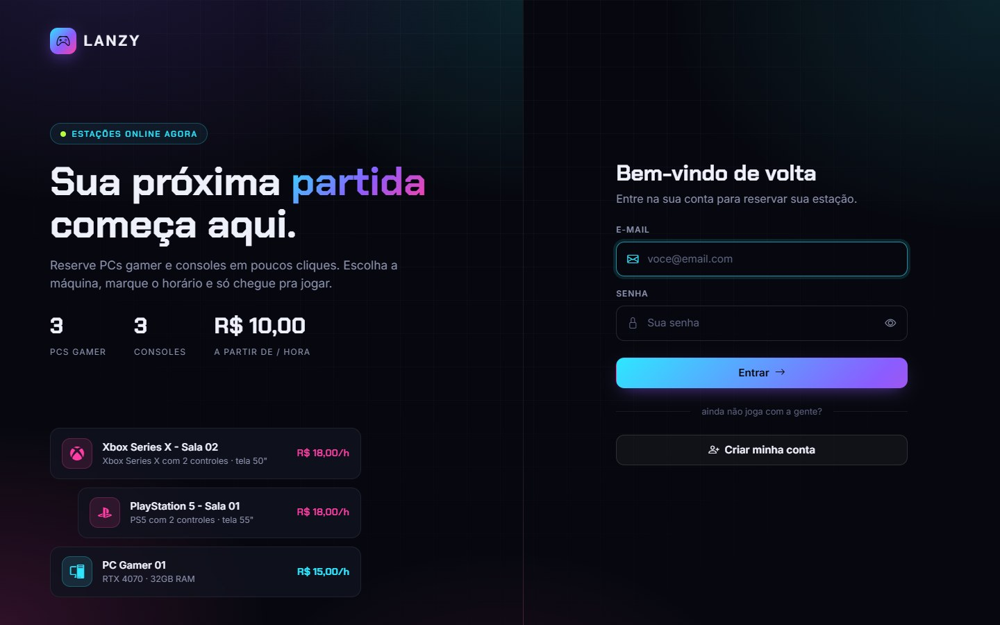
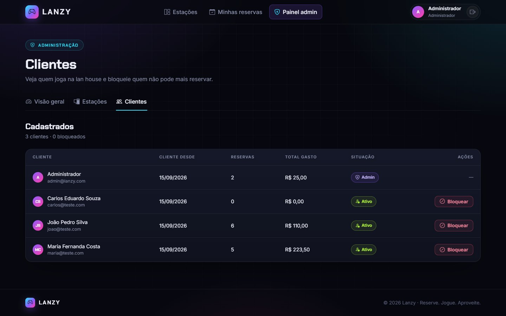
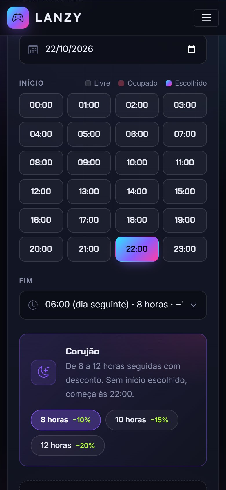
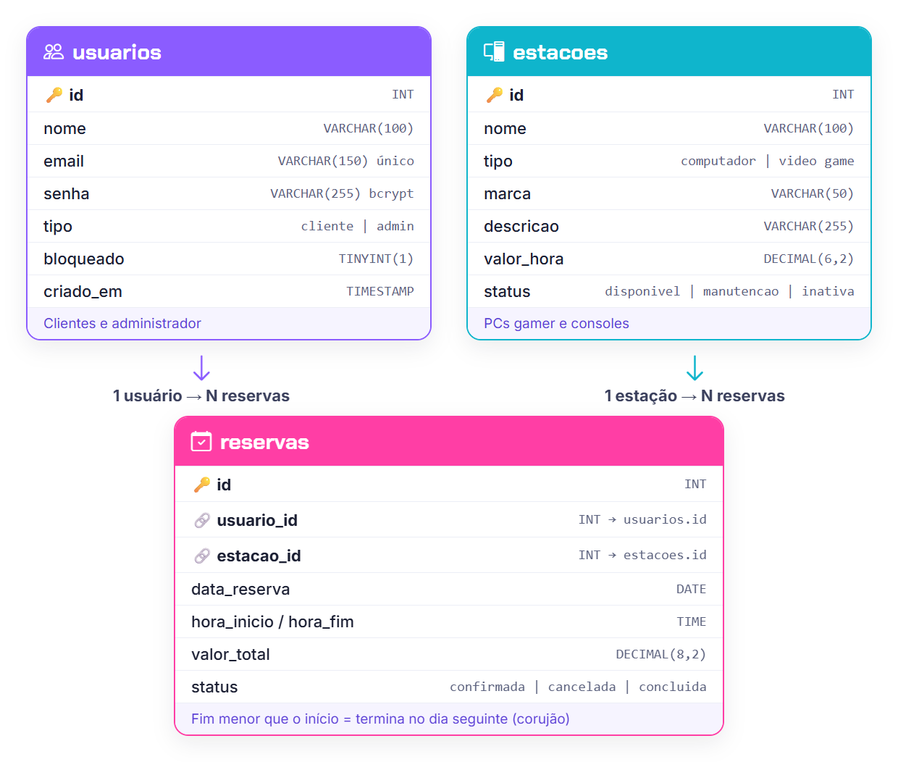

<p align="center">
  
</p>

<p align="center">
  
  
  
  
</p>

# Lanzy — Sistema de reservas para lan house

Sistema web para uma lan house alugar **PCs gamer e consoles por hora**. O cliente vê quais máquinas estão livres, escolhe o horário e reserva on-line; o dono acompanha tudo por um painel administrativo com faturamento, gestão de estações e controle de clientes.

Projeto acadêmico desenvolvido na **UNIPAC Uberlândia** (2026), feito em **PHP puro, sem framework**, com MySQL e Bootstrap.



## Funcionalidades

**Para o cliente**
- Cadastro e login.
- Vitrine de estações com filtro (PCs ou consoles) e disponibilidade em tempo real: *Disponível*, *Em uso até 21:00* ou *Manutenção*.
- Reserva em horas cheias: o início é escolhido numa grade de 24 horas (ocupadas aparecem riscadas) e o fim numa lista que já mostra duração e desconto.
- **Corujão:** sessões de 8 a 12 horas seguidas, inclusive virando a noite, com desconto automático (8h: 10%, 10h: 15%, 12h: 20%).
- Valor calculado na hora, antes de confirmar.
- "Minhas reservas", com próximas, histórico e cancelamento.

**Para o administrador**
- Painel com indicadores: estações, reservas ativas, clientes e faturamento.
- Lista de todas as reservas, com cancelamento.
- CRUD de estações: cadastrar, editar (nome, marca, valor, configuração), colocar em manutenção, desativar e excluir.
- Gestão de clientes com total gasto e **bloqueio**: o cliente bloqueado não consegue entrar e tem as reservas futuras canceladas.

## Destaques técnicos

- **Reservas que passam da meia-noite:** quando a hora de fim é menor que a de início, a reserva termina no dia seguinte. A checagem de conflito considera o dia anterior e o seguinte, então um corujão das 22:00 às 08:00 bloqueia corretamente a madrugada.
- **Sem reserva dupla:** a gravação acontece dentro de uma transação que trava a estação (`SELECT ... FOR UPDATE`), então dois pedidos simultâneos para o mesmo horário não passam juntos.
- **Valor gravado na reserva:** mudar o preço de uma estação não altera reservas antigas nem o faturamento passado.
- **Histórico preservado:** estação com reservas é desativada, não apagada; a exclusão física só é permitida para estações sem histórico.
- **Validação no servidor:** horas cheias, duração de 1 a 12 horas, só horários futuros, até 60 dias de antecedência e tamanho máximo dos textos. A tela ajuda, mas quem decide é o servidor.
- **Segurança:** senhas com bcrypt, token CSRF em todos os formulários, cookie de sessão `HttpOnly` + `SameSite`, sessão renovada no login, consultas preparadas (PDO), escape de toda saída e MySQL em modo estrito.
- **Banco enxuto:** todas as regras cabem em 3 tabelas.

## Telas

| Reserva com corujão | Minhas reservas |
|---|---|
|  |  |

| Painel administrativo | Gestão de estações |
|---|---|
|  |  |

| Login | Gestão de clientes |
|---|---|
|  |  |

<p align="center">
  
  &nbsp;&nbsp;
  
</p>
<p align="center"><em>Layout responsivo no celular</em></p>

## Banco de dados



| Tabela | Guarda |
|---|---|
| `usuarios` | Clientes e administradores (senha com bcrypt, perfil e bloqueio) |
| `estacoes` | PCs e consoles (tipo, marca, configuração, valor por hora e situação) |
| `reservas` | Cada horário reservado (data, início, fim, valor gravado e status) |

## Tecnologias

- **Back-end:** PHP 7.3+ sem framework, PDO
- **Banco:** MySQL 8 (compatível com MariaDB)
- **Front-end:** HTML, CSS, Bootstrap 5.3, Bootstrap Icons e JavaScript puro
- **Fontes:** Chakra Petch e Inter (Google Fonts)

## Como rodar

**Requisitos:** PHP 7.3 ou superior e MySQL 8 (ou MariaDB). Funciona com XAMPP, WampServer, Laragon ou AppServ.

1. Copie a pasta do projeto para a pasta pública do servidor (por exemplo, `htdocs` no XAMPP).
2. No phpMyAdmin, importe `database/schema.sql`. Ele cria o banco `lanzy_reservas`, as 3 tabelas, 6 estações de exemplo e o administrador.
3. Por padrão a conexão usa `root` sem senha. Se o seu MySQL tiver senha, copie `config/local.exemplo.php` para `config/local.php` e coloque a senha lá (esse arquivo não é versionado).
4. Acesse `http://localhost/lanzy-reservas/`.

Também dá para usar o servidor embutido do PHP, de dentro da pasta do projeto:

```bash
php -S localhost:8000
```

**Acesso de demonstração**

| Perfil | E-mail | Senha |
|---|---|---|
| Administrador | `admin@lanzy.com` | `admin123` |
| Cliente | crie uma conta na tela de cadastro | — |

> Troque a senha do administrador antes de usar o sistema de verdade.

## Estrutura

```
lanzy-reservas/
├── admin/                      # Painel: visão geral, estações, edição e clientes
├── assets/
│   ├── css/style.css           # Identidade visual
│   └── js/script.js            # Grade de horas, lista de fim e cálculo do valor
├── config/
│   ├── database.php            # Conexão PDO
│   └── local.exemplo.php       # Modelo para a senha do MySQL de cada máquina
├── database/
│   ├── schema.sql              # Criação do banco + dados de exemplo
│   └── atualizacao_v2/v3.sql   # Atualizam bancos criados com versões antigas
├── includes/
│   ├── auth.php                # Sessão, permissões e CSRF
│   ├── helpers.php             # Regras: horários, corujão, conflitos, valores
│   └── header/footer/...       # Partes visuais reaproveitadas
├── dashboard.php               # Vitrine de estações
├── reservar.php                # Tela de reserva
├── processa_reserva.php        # Validação e gravação da reserva
├── minhas-reservas.php         # Agenda do cliente
└── login.php / cadastro.php
```

## Autores

- **Dyérick Reis** — [@DyerickRC](https://github.com/DyerickRC)
- **Vinicius Silva** — [@vini323](https://github.com/vini323)
- **Nicolas Cantuario** — [@NicolasSamuel0](https://github.com/NicolasSamuel0)

Projeto acadêmico — UNIPAC Uberlândia, 2026.
